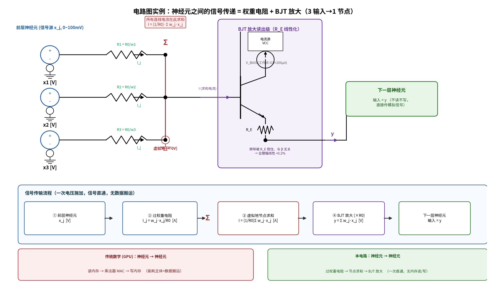

# 把 270 亿参数刻进硅片：电流模虚拟地"参数即电阻"的模拟 AI 推理芯片

**Etching 27 Billion Parameters into Silicon: A Current-Mode Virtual-Ground "Weights-as-Resistors" Analog AI Inference Chip**

> 电路级可行性、能效与成本论证 · Circuit-level feasibility, energy efficiency, and cost analysis

传统模型推理过程：权重与激活值分别存放在 GPU的显存中，每一个数据的传递都是"读出权重 → 搬运到计算单元 → 数字乘累加（MAC）→ 写回结果"；推理的大部分能耗与延迟都在数据搬运上。

新思路推理过程使用三极管工作原理：把模型权重直接刻进硅片，一个参数就是一个电阻的阻值（参数即电阻）；上一层神经元的模拟信号流经这些"参数电阻"时，欧姆定律与叠加原理让加权求和 Σw·x 在电流汇入求和节点的瞬间自然完成，三极管电路只对求和结果做线性放大读出。"存权重"与"算矩阵乘"退化为同一个物理过程，数据搬运从物理上消失。

推理速度与能耗（以 Qwen3.8-27B 单上下文、INT4 档计）：推理速度从 H100 单流的 ~60 tok/s 提到 ~87,000 tok/s，约 1,450 倍（对比 H100 批处理 ~600 tok/s 约 145 倍）；每 token 能耗从单流的 11.7 J 降到 2.4–23.6 mJ，省约 500–4,900 倍（对比 H100 批处理 1.17 J 约 50–490 倍）。

- 📄 中文论文：[`paper.md`](paper.md)（640 行，7 章 5 问题）
- 📄 英文论文：[`paper_en.md`](paper_en.md)（全篇翻译）
- 🔬 14 个可复跑仿真：[`sim/`](sim/)
- 📊 8 张图（全部由脚本生成、可复现）：[`sim/figs/`](sim/figs/)
- 📚 参考文献全文/摘要：[`refs/`](refs/)
- 📋 审核轮次记录：[`rounds/LOG.md`](rounds/LOG.md)

## 核心问题

> 现代 AI 模型几乎都依赖 GPU 推理。设计一个新芯片：直接把参数写入芯片。
> 依据三极管放大电路原理，上一层的连接线为特定电阻，电阻值由模型参数算出；
> 多条连接线汇入后等效电阻变化，节点三极管放大信号与电流随之变化。
> ——论证可行性、查资料、反复审核论证。



## 一句话结论

**条件可行（conditionally feasible）。** 朴素"电压注入基极"拓扑不成立
（指数失真 + 2.56 mA/节点直流倒灌），必须修正为 **电流模虚拟地 crossbar +
BJT 电流镜读出**：模拟信号全程电流、求和节点为虚地、三极管做线性读出放大。
该拓扑与权威文献 Bowen (arXiv 2302.06417) 的电路描述**逐字对应**，技术谱系
ANNA(1989) → NorthPole(2016) → Mythic(2018) → Bowen(2023) 完整支撑。

## 关键定量结果（全部来自可复跑仿真）

| 维度 | 结果 |
|------|------|
| 精度 | SNR 与层宽 W 无关、∝R0^-½、∝吞吐^-½；INT8 窗口 = R0≤288kΩ@10MOPS 或 1MΩ@≤2.9MOPS；0.1% 容差即可 INT8，1% 容差统计抵消后仅损失 1.32% |
| 规模（Qwen3.8-27B） | 面积税 1 参数=1 单元：45nm=1080cm²（≈126 reticle，仅实验室原型）→ 7nm=27cm²（3.1 reticle）→ 3nm=11cm²（1.3 reticle，单封装可行，工艺分界） |
| 吞吐 | INT8 ~1,200 / 6bit ~5,400 / INT4 ~87,000 tok/s（单上下文 4k，全层并行） |
| 能效 | INT4 每 token 2.4–24 mJ：比 H100 批处理(1.17 J/token)省 ~50–490 倍、比单流(11.7 J/token)省 ~500–4,900 倍（固定权重 e_op∝1/N） |
| 工艺成本 | 27B 硅+MCM：45nm ~$13k / 28nm ~$7.4k / 14nm ~$3.2k / 7nm ~$2.4k（最省）/ 3nm ~$2.6k——**成熟 28/14nm 并不更便宜**，甜点在 7–14nm；无 HBM 省 H100 的 8×HBM3（~$5–8k） |
| 热 | 噪声类温度项可忽略（共模抵消红利）；唯一真凶是 BJT 指数漏流 IS（每 +7°C 翻倍），液冷压 Tj<50°C 即可 |
| 3D | 占位 ↓3.8 倍、体积 ↓2.2 倍（7nm 下 3 reticle → 单 reticle） |
| 读出模态 | BJT(电流控制, 45nm 首选) 与 MOS TIA(电压控制, 7/3nm 必选) 两种模态均可行；最优前端 = 电流模差分 + 电荷采样，架构消解模态失配 |

## 适用边界（诚实声明）

- **本方案胜**：大模型固定权重推理、INT4~INT8、追求每焦耳 token（边缘/单流/数据中心低精度推理）
- **GPU 仍胜**：训练、大 batch、FP16/BF16 高精度、动态图

## 复现

所有仿真依赖 numpy + matplotlib（Python 3.10+）：

```bash
pip install -r requirements.txt
cd sim
python sim_v12_qwen27b.py     # Qwen3.8-27B 体积/功率/效率
python sim_v13_thermal_3d.py  # 发热/3D 堆叠
python sim_v14_readout_cm.py  # BJT vs MOS 读出模态
python sim_v15_process_cost.py # 工艺成本
python fig_readout_diff.py    # 图 8（带 0 重叠自检）
```

`rounds/LOG.md` 记录了 R0–R14 每一轮审核改了什么、推翻了自己哪些错误结论
（含多次自我纠错：SNR 90dB 上界误报 → 严格 MC 49.9dB；H100 能效单位错 1000× 的修正等）。

## 目录结构

```
AI_chip_paper/
├── paper.md              # 中文论文（640 行）
├── paper_en.md           # 英文论文（全篇翻译）
├── requirements.txt
├── LICENSE               # MIT
├── sim/                  # 14 个仿真脚本 + 8 张图的生成脚本
│   ├── sim_v1.py … sim_v15_process_cost.py
│   ├── fig3layer_wiring.py / fig_circuit_flow.py / fig_readout_diff.py
│   ├── plot_figs.py
│   └── figs/             # fig1–fig8 (PNG+PDF)
├── refs/                 # 文献全文/摘要 (Bowen 2302.06417, 1606.07786 等)
└── rounds/LOG.md         # R0–R14 审核轮次记录
```

## 许可证

MIT（见 [LICENSE](LICENSE)）。
